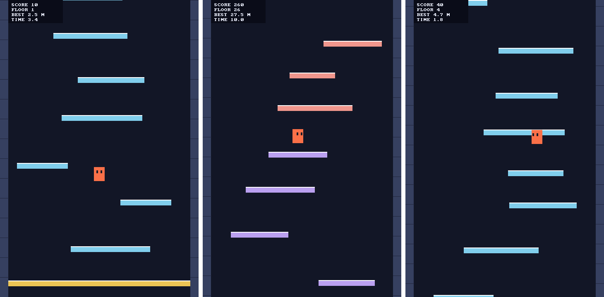

<div align="center">


<br />


<br />

<p>
  <a href="#download-the-single-file-compiler"></a>
  <a href="#why-botlish"></a>
  <a href="#a-tour"></a>
  <a href="#getting-started"></a>
  <a href="#how-it-is-built"></a>
  <a href="docs/INDEX.md"></a>
</p>

<p>
  <a href="https://github.com/mwagner-webdev/botlish/actions/workflows/tests.yml"></a>
  <a href="#why-tcl"></a>
  
  
  
  
  
</p>

</div>

**A high-level, native-capable, safe and friendly language for building
applications, designed to be written and read by humans and agents alike.**

Botlish reads like a scripting language: indentation, closures, immutable
bindings, loops that are expressions. Underneath, its compiler proves things
about your program: which errors a call can actually raise, which Strings
have passed a validation, who owns a coroutine, whether two lists have the
same length. What it proves, it takes off your hands: a handler for an error
that cannot happen is not needed, a check that cannot fail is not emitted,
and many high-level abstractions leave no trace in the machine code. What it
cannot prove, it asks you to say.

Botlish is **value-oriented**, in the spirit of Erlang, SQL and Tcl: a
program computes with values that are what they contain (compared, hashed
and printed by content) rather than with objects that have an identity.
Bindings are immutable, nothing is shared by reference, and even the mutable
collections, `MutableVector` and `MutableArray`, are values: copy-on-write,
and changed only through a binding the compiler can see.

The same program runs on a reference interpreter, on a compiler to Tcl, and
on a native backend that compiles through [Cranelift](https://cranelift.dev)
to machine code, either just in time or as a standalone Linux x86-64
executable.

```botlish
import std::io
import std::linux::io

fn hello() errors std::io::WriteFailed:
    std::io::print_line("Hello, world!")

with context std::linux::io::create()

hello():
    on std::io::WriteFailed:
        unit
```

```console
$ tclsh9.0 main.tcl -emit-native-executable examples/io/hello.bot
$ examples/io/hello
Hello, world!
unit
```

(An executable prints its program's value last: here `unit`.) `hello` never
says where its output goes. `std::io::print_line` needs an `std::io::IO` context; the
program installs one, `std::linux::io::LinuxIO`; and the compiler turns the call
into a direct call of `std::linux::io::write_text`, which is one `write(2)` system
call: no dispatch, no hidden argument, no libc in the path. The one way
`hello` can fail, `std::io::WriteFailed`, is part of its signature, and its caller
handles it. ([examples/io/hello.bot](examples/io/hello.bot),
[CONTEXT-TRAITS.md](docs/CONTEXT-TRAITS.md)) On macOS the same `hello`
runs with `std::darwin::io::create()` installed instead, and the write is
libSystem's `write(2)`, called through the C FFI
([examples/io/hello-darwin.bot](examples/io/hello-darwin.bot),
[MACOS-AARCH64-MILESTONE-8.md](docs/MACOS-AARCH64-MILESTONE-8.md)).

## Download the single-file compiler

<p align="center">
  <a href="https://github.com/mwagner-webdev/botlish/releases/download/single-latest/botlish-linux-x86_64"></a>
</p>

The whole compiler is one Linux x86-64 executable: the command line, the
standard library, every backend and the native code generator, in a single
file that needs nothing but glibc (2.39 or newer). There is no Tcl, Rust, C
compiler or linker to install, and the standalone executables it builds need
nothing else either. CI builds it from `main` on every push and publishes
each build that passes its smoke tests, run in stock Ubuntu containers, as
the [`single-latest` release](https://github.com/mwagner-webdev/botlish/releases/tag/single-latest),
with its SHA-256 checksum. Save the program above as `hello.bot`, then:

```sh
curl -fLo botlish https://github.com/mwagner-webdev/botlish/releases/download/single-latest/botlish-linux-x86_64
chmod +x botlish
./botlish -backend cranelift hello.bot                   # run natively, just in time
./botlish -emit-native-executable hello.bot && ./hello   # build a standalone executable
./botlish -help                                          # Compilerpedia, the built-in reference
```

**C calls.** A program that calls C (`extern c fn`,
[C-FFI.md](docs/C-FFI.md)) links with the single-file compiler too, through
the host's C compiler driver: install one (`apt install gcc`) and the C
libraries the program declares, and pass their directory with `-L DIR`.
Neither Rust nor a checkout is needed: the compiler carries its precompiled
runtime and links it into the executable, which then runs without the
compiler ([SINGLE-EXECUTABLE-FFI-MILESTONE-1.md](docs/SINGLE-EXECUTABLE-FFI-MILESTONE-1.md)).
Every other program still links with no toolchain at all. How the single
file is built and what it runs: [SINGLE-EXECUTABLE.md](docs/SINGLE-EXECUTABLE.md).

## Icy Tower, a game in Botlish

<p align="center">
  
</p>

[examples/games/icy-tower/](examples/games/icy-tower/) is a small real-time
game in the style of Icy Tower: about 1,300 lines of ordinary Botlish over
the [generated SDL3 binding](docs/C-BINDGEN.md). It opens a window, reads the
keyboard, bounces the player off platforms under gravity, generates the
tower forever, scrolls the camera up, keeps the score, and restarts. It
compiles to one native Linux x86-64 executable of under 1 MB, with no assets
beside it.

<p align="center">
  <a href="https://github.com/mwagner-webdev/botlish/raw/main/audit/icy-tower/artifacts/icy-tower"></a>
</p>

```sh
curl -fLo icy-tower https://github.com/mwagner-webdev/botlish/raw/main/audit/icy-tower/artifacts/icy-tower
chmod +x icy-tower
./icy-tower      # Left/A and Right/D move, R restarts, Escape quits
```

It needs SDL 3 (`libSDL3.so.0`, from your distribution's SDL 3 package) and
glibc 2.34 or newer. `examples/games/icy-tower/build.sh` builds it from a
checkout, where the generated SDL3 binding is.
Its rules run headless on all four backends, the executable agrees with an
independent oracle, and valgrind finds no leaks
([ICY-TOWER-VERTICAL-SLICE-1.md](docs/ICY-TOWER-VERTICAL-SLICE-1.md)).

## Botlish and Rust

Botlish shares some of Rust's goals: native code, errors in a function's
signature, abstractions that cost nothing at run time. It aims at different
work. Rust is a systems language: it gives you exact control over memory
layout, allocation, sharing and threads, and its borrow checker makes that
control safe, at the price of lifetimes and ownership in nearly every
signature. Botlish is for building applications, and trades that control for
simplicity: values instead of references, memory managed by the runtime,
representation left to the compiler, and no borrow checker or lifetimes (its
one ownership rule, affinity, applies only to resources such as coroutine
handles). Concurrency follows the same trade. Rust offers a flexible kit of
threads, locks, channels and async runtimes; Botlish is heading for one
opinionated, actor-like model. By default, actors are isolated computations
that share nothing and exchange values; a value is shared only where the
program explicitly declares it shared, so sharing is always visible in the
code. (Today Botlish has coroutines; the actor model is planned.) If you
need a custom allocator, a hand-tuned memory layout or a lock-free data
structure, use Rust. If you would rather the compiler made those decisions,
Botlish is meant for you.

Botlish also builds the development tooling into the compiler instead of
leaving it to separate tools. Its warnings are an integrated linter (think
ESLint, built in, backed by proofs, with nothing to configure), and its test
framework is ordinary Botlish. Planned next: a "compilerpedia", where the
compiler itself carries the language's documentation; `botlish explain`,
which asks the compiler what it knows about a definition
(`botlish explain types module::submodule::function`); and an interpreter
built for rich debugging.

## Why Botlish

* **High-level.** Values, not references; `Int` is arbitrary precision
  (nothing overflows), `Float64` is finite (an operation that would make NaN
  or an infinity fails with a declared error instead), a String is a
  sequence of Unicode scalar values, and
  memory is managed for you. Closures, structs and destructuring, enums,
  traits, coroutines and modules, with a small standard library written in
  Botlish itself.
* **Native-capable.** One semantics, several backends. The native one
  lowers the analyzed program to its own IR and then to machine code with
  Cranelift. Standalone executables are self-contained, and Botlish code
  reaches the Linux kernel directly (`std::linux::abi::x86_64::syscall`,
  `std::linux::abi::aarch64::syscall`): the I/O library above is ordinary Botlish
  source, the same on both architectures.
* **Safe.** Every error a function can raise is in its signature, and every
  call that might raise it handles it or declares it. A refinement type such
  as `std::web::Emailish` carries a proof only its owning module can produce, and
  an integer domain such as `std::byte::Byte` (`Int in 0..255`) is checked by
  range analysis. Access to the environment is explicit too: a function that
  does I/O needs a context (such as `std::linux::io::LinuxIO`, which only its own
  module can create), the compiler derives that requirement through every
  caller, and only the entry program installs contexts. Contexts are
  capabilities, and the standard library is being built with capability
  security as its design goal. Coroutine handles are affine: using one after
  moving it is a compile-time error. A declared parameter type is a static
  obligation at every call, never a run-time check.
* **Friendly.** Indentation-based syntax, method-call sugar, loop
  expressions instead of a zoo of combinators, and diagnostics that say what
  is wrong, where, and usually what to write instead. Warnings exist only
  where the compiler can prove the finding, with one policy for the whole
  compilation (`-warnings default|off|error`) and nothing to tune.
* **For agents as well as people.** Contracts are checked, not documented:
  what a call can fail with, what a value has been proven to be, where
  ownership moves. Diagnostics name a kind, a location and a cause. And
  "this must not compile" is an ordinary test: `static compile:` turns a
  compiler rejection into a value a Botlish program can inspect. The test
  suite checks every backend against the reference interpreter.

## A tour

Every program below runs, with the value shown, on the interpreter, the Tcl
compiler and the native backend.

### Loops are expressions

A loop over a domain collects its body's values into a List. `continue`
contributes nothing, so a filter is just a loop; `return` leaves the
function; and clauses joined by `and` advance in lockstep, over iteration
counts the compiler must prove equal.

```botlish
import std::list
import std::str

squares = loop i from 1 through 5:
    i * i

countdown = loop i down from 3 through 1:
    i

odd_squares = loop s in squares:
    if s.mod(2) == 0:
        continue
    s

names = ["ada", "grace", "edsger"]
numbered = loop name in names and i from 1 through std::list::length(names):
    [i, name]

fn first_long(words: List[str]) -> str:
    loop word in words:
        if std::str::length(word) > 4:
            return word
    "none"

[squares, countdown, odd_squares, numbered, first_long(names)]
# [[1, 4, 9, 16, 25], [3, 2, 1], [1, 9, 25],
#  [[1, "ada"], [2, "grace"], [3, "edsger"]], "grace"]
```

`loop x in [1, 2] and y in [1, 2, 3]:` does not compile: *lockstep loop
requires equal iteration counts; clause 1 iterates 2 times but clause 2
iterates 3 times*. ([COLLECTING-LOOPS.md](docs/COLLECTING-LOOPS.md))

### Errors are contracts, and proofs make them disappear

An error is a declared name, possibly with a payload. A function lists the
errors it can raise, and every call either handles them or declares them.
`std::byte::from_int` from the standard library ([stdlib/byte.bot](stdlib/byte.bot)):

```botlish
type Byte = Int in 0..255

fn from_int(value: int) -> Byte errors BelowRange, AboveRange:
    if value < 0:
        fail BelowRange
    elif value > 255:
        fail AboveRange
    else:
        value
```

The obligation is decided per call, from what the compiler knows about that
call's arguments: provable success needs no handler, provable failure is a
compile-time error, and only a genuinely uncertain call has to deal with the
error.

```botlish
import std::byte
import std::immutable_set

# A dynamic Int: both declared errors are possible, so both are handled.
fn to_byte(n: int) -> std::byte::Byte:
    std::byte::from_int(n):
        on std::byte::BelowRange:
            0
        on std::byte::AboveRange:
            255

# Proven in range at this call: no handler, no `errors` clause.
dot = std::byte::from_int(46)

# Every element is a known character below U+0100, so std::byte::set's
# AboveRange is proven impossible here: no handler either.
unreserved = std::byte::set(['-', '.', '_', '~'])

[to_byte(-5), to_byte(300), unreserved.contains(dot)]   # [0, 255, true]
```

Leave out `to_byte`'s handlers and the call is rejected (*may produce the
declared error "std::byte::AboveRange", which is neither handled here nor
admitted by the enclosing function's own "errors" declaration*). Write
`std::byte::from_int(999)` and it is rejected too, handler or not: *this call can
never complete normally under the facts proven for its arguments here*.
([STATIC-COMPLETION-PROOFS.md](docs/STATIC-COMPLETION-PROOFS.md),
[ERROR-PAYLOADS.md](docs/ERROR-PAYLOADS.md))

### Proofs you can name

A refinement type is a nominal type over a carrier, with the carrier's exact
run-time representation. Only its owning module can prove a value into it:
[stdlib/web.bot](stdlib/web.bot) declares

```botlish
refined type Emailish = str

fn emailish?(v: str) -> bool proves v: Emailish:
    ...
```

and any program can then use the proof:

```botlish
import std::str
import std::web

fn contact(address: std::web::Emailish) -> int:
    std::str::length(address)

address = "foo@x.com.au"

n = if std::web::emailish?(address):
    contact(address)        # address is a std::web::Emailish in this branch
else:
    0

prefix = if std::str::length(address) < 3:
    ""
else:
    address.substring(0, 3) # in bounds, proven: no handler needed

[n, prefix]                 # [12, "foo"]
```

Calling `contact("foo@x.com.au")` directly is a compile-time error: *a
refinement proof is required ... there is no implicit conversion*. A
validator works the same way through errors: after
`std::linux::path::validate(value)` completes, `value` is a
`std::linux::path::LinuxPath` and still a `str`
([examples/io/show-path.bot](examples/io/show-path.bot)). Integer domains
work alongside: `type Byte = Int in 0..255`, or an exact set such as
`HighNibble`, is a subtype of `Int` whose membership the range analysis
proves from comparisons and from checked results.
([REFINEMENT-VALUES.md](docs/REFINEMENT-VALUES.md),
[SOURCE-DEFINED-INTEGER-DOMAINS.md](docs/SOURCE-DEFINED-INTEGER-DOMAINS.md),
[examples/refinement/refined-strings.bot](examples/refinement/refined-strings.bot))

### Coroutines

A coroutine is started eagerly and runs to its first `yield`, which may be
any number of calls deep. Each later call of its handle resumes it with one
message of a statically fixed type.

```botlish
struct Message:
    value: int

struct Event:
    value: int

fn deep(base: int, resume Message) -> int:
    message = yield Event {value: base}
    message.value

fn worker(base: int, resume Message) -> Event:
    x = deep(base)
    message = yield Event {value: x}
    return Event {value: message.value}

coroutine {step, first} = worker(10)

second = step(Message {value: 20})
final = step(Message {value: 30})
again = step(Message {value: 999})
[first, second, final, again]
# [Event {value: 10}, Event {value: 20}, Event {value: 30}, Event {value: 30}]
```

The handle `step` is affine: it can move, but never be copied, so a
coroutine is never forked or aliased. Ending the program with these two
lines instead does not compile:

```botlish
other = step
step(Message {value: 1})
```

```text
program.bot:22:1: `step` was used after its coroutine value was moved

moved here:
    other = step  (program.bot:21:1)

used here:
    program.bot:22:1 (CORE SEMANTIC USE-AFTER-MOVE)
```

The compiler also releases a coroutine right after its handle's last use,
and on every early exit. ([COROUTINES.md](docs/COROUTINES.md),
[AFFINE-VALUES.md](docs/AFFINE-VALUES.md))

### Zero-cost abstractions

Traits are structural: a type satisfies `Named` because its own namespace
defines `name`, with no `implements`. A function over a trait is compiled
once per concrete type it is called with, and the trait disappears.

```botlish
trait Named:
    fn name(value: Named) -> str

struct Person:
    value: str

fn name(value: Person) -> str:
    value.value

fn describe(value: Named) -> str:
    value.name()    # the trait's operation, and nothing else of Person

describe(Person {value: "Alice"})   # "Alice", through describe<Person>
```

At run time there is no trait object, vtable, dictionary, tag or hidden
argument. In the committed evidence
([audit/traits/principal/](audit/traits/principal/)), `describe<Person>` is
the same 31 bytes of machine code as a hand-written
`describe_person(value: Person)`, and calling it allocates nothing. Not
every abstraction is free yet, but many follow the same rule: a refined
`std::web::Emailish` is exactly its `str`, a `std::byte::Byte` is exactly an `Int`, an installed context is a fixed
slot the compiler reads directly rather than an argument threaded through
every call, and a context trait such as `std::io::IO` becomes direct calls of the
installed implementation. ([TRAITS.md](docs/TRAITS.md),
[CONTEXTS.md](docs/CONTEXTS.md))

### Tests are Botlish programs

[stdlib/test.bot](stdlib/test.bot) is an ordinary library: no test syntax, no
assertion keyword, no test-only native. A suite is a context holding a
`MutableVector` of cases, the runner is a coroutine, and `static compile:`
turns "the compiler rejects this" into an ordinary value, so a test can
expect a compile error as easily as a result. An excerpt of
[tests/golden/loop-collecting.bot](tests/golden/loop-collecting.bot), one of
the 90 golden suites that run on every backend:

```botlish
import std::compiler
import std::list
import std::test

fn register_lockstep_tests():
    # x in xs and i from 0 to std::list::length(xs).
    fn length_proof() errors std::compiler::CompilerError:
        static compile:
            fn f(xs):
                loop x in xs and i from 0 to std::list::length(xs):
                    [x, i]
            f([10, 20])
    std::test::value("loop-collecting-lockstep-length-proof", [[10, 0], [20, 1]], length_proof)

    # Literal lists of different length.
    fn literal_vs_literal() errors std::compiler::CompilerError:
        static compile:
            fn f():
                loop x in [1, 2] and y in [1, 2, 3]:
                    x
            f()
    std::test::rejects("loop-collecting-reject-literal-vs-literal", std::compiler::DiagnosticCode::LockstepUnequal, literal_vs_literal)

with context std::test::suite()
register_lockstep_tests()
std::test::report()
# ["PASS loop-collecting-lockstep-length-proof",
#  "PASS loop-collecting-reject-literal-vs-literal", "2 passed, 0 failed"]
```

([GOLDEN-TEST-FRAMEWORK.md](docs/GOLDEN-TEST-FRAMEWORK.md),
[STATIC-COMPILE.md](docs/STATIC-COMPILE.md),
[tests/golden/README.md](tests/golden/README.md))

### And more

Structs with [destructuring](docs/STRUCT-DESTRUCTURING.md) and
[opaque](docs/OPAQUE-STRUCTS.md) construction, [enums](docs/ENUMS.md),
[errors with payloads](docs/ERROR-PAYLOADS.md),
[`MutableVector`](docs/MUTABLE-VECTOR.md) and
[`MutableArray`](docs/MUTABLE-ARRAY.md) with value semantics,
[structural function types](docs/STRUCTURAL-FUNCTION-TYPES.md),
[flag parameters](docs/FLAGS.md), [method-call sugar](docs/METHOD-SUGAR.md),
[modules and explicit imports](docs/IMPORTS.md) with the standard library
under [one root, `std`](docs/STD-NAMESPACE.md),
[`mutual:` recursion groups](docs/MUTUAL-RECURSION.md), and
[compiler warnings](docs/WARNINGS-SAME-RETURN.md) backed by proofs. Every
feature keeps the [language design principles](docs/LANGUAGE-DESIGN-PRINCIPLES.md)
-- SFIAE: an operation's unmet obligations are an error, never a reason to
choose another. [docs/INDEX.md](docs/INDEX.md) lists every design document.

## Getting started

You need Tcl 9.0 (`tclsh9.0`; AGENTS.md shows how CI installs it on Ubuntu)
and, for the native backend, a stable Rust toolchain (1.95 or newer).

```sh
export LANG=C.utf8 LC_ALL=C.utf8

tclsh9.0 main.tcl examples/surface/02-recursion.bot           # run on the reference interpreter
tclsh9.0 main.tcl -backend compile examples/stdlib/csv.bot    # run through the Tcl compiler

cargo build --release --manifest-path native/Cargo.toml       # build the native backend
tclsh9.0 main.tcl -backend cranelift examples/stdlib/csv.bot  # run natively, just in time
tclsh9.0 main.tcl -emit-native-executable examples/io/hello.bot && examples/io/hello
tclsh9.0 main.tcl -backend cranelift examples/games/2048/demo.bot  # a program and its own module beside it; prints the game

tclsh9.0 tests/golden/run.tcl tests/golden/coroutines.bot     # one golden suite, on every backend
tclsh9.0 tests/local.tcl                                      # the whole test suite, in parallel
```

`single/build.sh` packs the compiler, both native executables and the
standard library into one Linux x86-64 executable that needs nothing but
glibc ([SINGLE-EXECUTABLE.md](docs/SINGLE-EXECUTABLE.md)), the one
[the download button](#download-the-single-file-compiler) above fetches.

## How it is built

```
source ──parse──▶ AST ──lower──▶ HIR ──┬──▶ core IR ──▶ reference interpreter
                                       ├──────────────▶ Tcl compiler
                                       └──▶ NIR ──▶ Cranelift ──▶ machine code (JIT, objects, executables)
```

HIR, the semantic representation, is where every analysis lives: name
resolution, types, ranges and exact values, completion proofs, ownership,
trait monomorphization, warnings. Every backend compiles the same analyzed
HIR, and the native path never goes through core IR
([DIRECT-HIR-NATIVE-PATH.md](docs/DIRECT-HIR-NATIVE-PATH.md)). The compiler
front end and the reference interpreter are written in Tcl, as an
executable specification that favors clarity over speed; the native runtime
and code generation are Rust. [docs/README.md](docs/README.md) is the full
reference.

| Directory | Contents |
|---|---|
| `surface/` | lexer, parser, surface AST, lowering to HIR |
| `hir/` | the semantic representation and its analyses |
| `core/` | core IR, values, and the reference interpreter |
| `compiler/` | the HIR to Tcl compiler |
| `native/` | the native backend: lowering to NIR (Tcl), runtime and code generation (Rust) |
| `stdlib/` | the standard library, in Botlish: the namespace `std` (`stdlib/list.bot` is `std::list`) |
| `examples/` | example programs; `examples/stdlib/` is the algorithm corpus |
| `tests/` | the Tcl test suite; `tests/golden/` holds the suites written in Botlish |
| `bench/` | benchmarks |
| `audit/` | fuzzers, mutation harnesses, and the evidence behind the design documents |
| `fuzz/` | the AFL++ campaign over the example executables |
| `single/` | the single-file compiler |
| `docs/` | the reference and the design documents ([index](docs/INDEX.md)) |
| `main.tcl` | the command line |

Contributors, human or not, start with [AGENTS.md](AGENTS.md): how to run
the tests, and what to re-run when you change a given part of the compiler.

## Why Tcl

The front end, the reference interpreter, the Tcl compiler, the lowering to
NIR and the tools around them (the C binding generator, Compilerpedia, the
test harness) are written in Tcl 9. This is a deliberate long-term choice.
It is not a prototype waiting to be rewritten.

* **Tcl is small enough to replace.** Its syntax is a dozen rules, and small
  teams have reimplemented it several times: [Jim Tcl](https://jim.tcl-lang.org)
  in C, [Eagle](https://eagle.to) for .NET, and TH1, a cut-down Tcl from the
  SQLite project that now lives in Fossil. If Tcl ever died, or moved in a
  direction Botlish cannot follow, the part of it the compiler uses could be
  reimplemented in Botlish the same way. Botlish does not depend on Tcl's
  upstream staying what it is.
* **Tcl is the glue.** Compiler orchestration stays in Tcl, and so will
  plugin orchestration: the coming plugin infrastructure is being built on
  it. Tcl is not the only glue language, nor the most featureful, but it has
  the best balance of size, features and development speed. The C binding
  generator is an early sign that this works.
  [`tools/c-bindgen.tcl`](tools/c-bindgen.tcl) drives a C toolchain, parses
  real headers, probes the target's ABI, and emits Botlish source and C
  thunks. It binds SDL3 (1217 functions), BoringSSL (3978), Win32 (3304) and
  Tcl's own C API (829) ([C-BINDGEN.md](docs/C-BINDGEN.md)).
* **Tcl is a good language to bootstrap a compiler in.** It is not very
  opinionated and has the quality of a construction kit: lists, dicts,
  namespaces, `uplevel`, `eval` and coroutines are general mechanisms that
  combine well. It also fits Botlish's value orientation. Tcl's lists and
  dicts are values, compared by content and copied on write; its integers
  are arbitrary precision; Tcl 9's strings hold every Unicode character.
  So HIR is a plain Tcl dict, which
  [HIR interchange](docs/HIR-INTERCHANGE.md) writes as text and reads back
  in another process. On the Tcl backends, each Botlish coroutine is one Tcl
  coroutine ([COROUTINES.md](docs/COROUTINES.md)). The interpreter's and the
  compiler's internals may be rewritten in Botlish one day, but only when
  that is actually needed.
* **Tcl core only.** The Tcl in Botlish's compiler infrastructure will only
  ever depend on the Tcl core and on extensions written in Botlish itself:
  no third-party extensions, not even Tcllib. Today that means `Tcl` and
  `tcltest`, which ships with Tcl. The core is all there is to keep working,
  so the code stays future-proof, and a Botlish reimplementation of Tcl
  would only ever need to cover the core.

## Status

Botlish is young and changes quickly; most of its features arrived as
milestones whose reports are in [docs/](docs/INDEX.md). CI runs the native
backend on x86-64 and arm64 Linux and on Apple Silicon macOS; native
coroutines, standalone executables and C calls run on Linux x86-64 and
AArch64 and macOS AArch64; Linux system calls are Linux only; the Tcl
backends run wherever Tcl 9 does.

## License

[MIT](LICENSE)

<div align="center">


</div>
